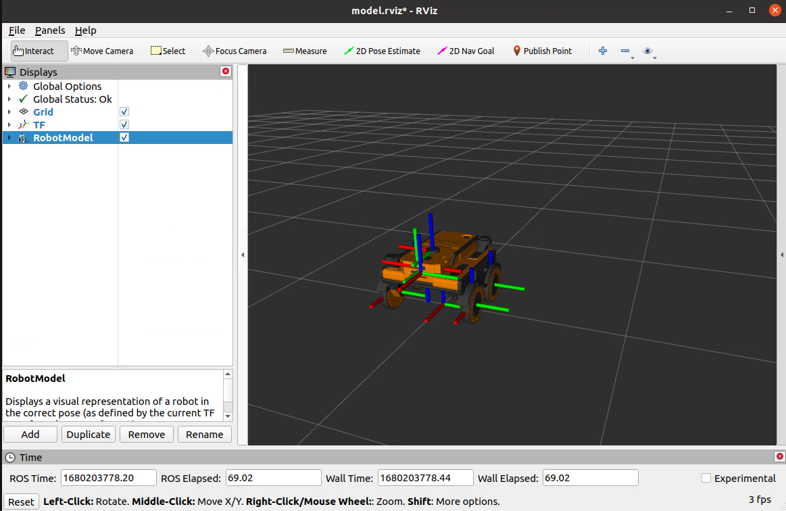

# Vitulus description
 URDF description of VITULUS. Package publish robot state, joints, tf. 

### NODES
  /
  
    joint_state_publisher (joint_state_publisher/joint_state_publisher)

    robot_state_publisher (robot_state_publisher/robot_state_publisher)

## Install

`cd ~/catkin_ws/src/vitulus`

`git clone https://github.com/lacina-dev/vitulus_description.git`

`cd ~/catkin_ws`

`catkin build`

## Run

`roslaunch vitulus_description vitulus4wd.launch rviz:=true joint_state_publisher:=true`

## Sensor positions (URDF) — calibration state

| sensor | frame | in `chassis` (= `base_link`) | how it is known |
|---|---|---|---|
| RPLidar C1 | `base_scan` | x 0.062, y 0, z 0.348 m, yaw −90° | yaw checked 2026-08-02 from driving: lidar ICP odometry has no crab angle (−0.14° fwd / +0.16° rev, i.e. 0 ± 0.2°) |
| RealSense D435 | `d435_bottom_screw_frame` | x 0.202, y 0.024, z 0.280 m, pitch −1.4° (nose up) | pitch from the ground plane 2026-07-19; the camera-internal frames (`d435_color_frame` …) come from the camera's factory extrinsics, published by the driver |

Check 2026-10-18 (robot in the dock, `vitulus_ui/tools/overlay_extrinsics.py static`):

- depth − lidar on the same surface: −0.015 m at ~1 m, +0.04 m at ~2 m, +0.185 m at ~3.8 m
  (≈ +0.013·z²) — a stereo depth bias of the D435 itself (fix: RealSense on-chip
  self-calibration / tare), not a URDF error; a URDF offset would not grow with z².
- lidar points vs depth edges: about +10 px (lidar left) at 3–4 m, −6 px at 1 m; the yaw / y
  fit points to camera yaw +1…+2° but the garage scene is too cluttered to prove it — no URDF
  change yet. Decide from an outdoor recording (flat wall / posts at 1.5–5 m) and a daylight
  drive (`overlay_extrinsics.py crab`: VO vs wheel odometry gives the camera yaw directly).

## Info

 More about VITULUS? See my website.
 [https://lacina.dev](https://lacina.dev)

 Questions? Try Discord.
 [Discord channel](https://discord.gg/YqeNV5hEVN)